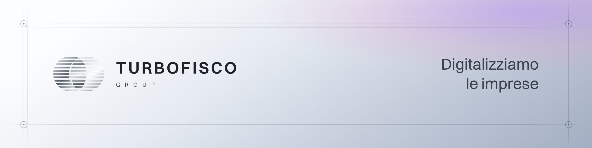

<picture>
  <source media="(prefers-color-scheme: dark)" srcset="assets/banner-scuro.jpg">
  
</picture>

 

**TurboFisco Group** sviluppa software su misura e rinnova i sistemi informativi di imprese, banche, assicurazioni e industrie. I nostri prodotti sono TurboFattura e TurboHR.

### I nostri prodotti

| | |
| --- | --- |
| **[TurboFattura](https://turbofattura.com)** | Il nostro software di fatturazione elettronica: emetti la fattura, la invii allo SdI e la segui fino alla consegna al cliente. |
| **[TurboHR](https://www.turbofiscogroup.it/turbohr)** in arrivo | Il nostro software per il personale: presenze, ferie e permessi con approvazioni in un unico posto. |

### Cosa facciamo

**Software su misura.** Progettiamo e sviluppiamo gestionali, applicazioni web e integrazioni costruiti attorno ai processi della tua azienda.

**La nostra AI per le imprese.** Stiamo sviluppando un’AI pensata per le imprese. Intanto integriamo modelli come Claude e ChatGPT nei processi e nei software che usi già.

### Contatti

[www.turbofiscogroup.it](https://www.turbofiscogroup.it) · [info@turbofiscogroup.it](mailto:info@turbofiscogroup.it)

TURBOFISCO GROUP SRL · Via Cicerone 60, 00193 Roma · P.IVA 18490541002
